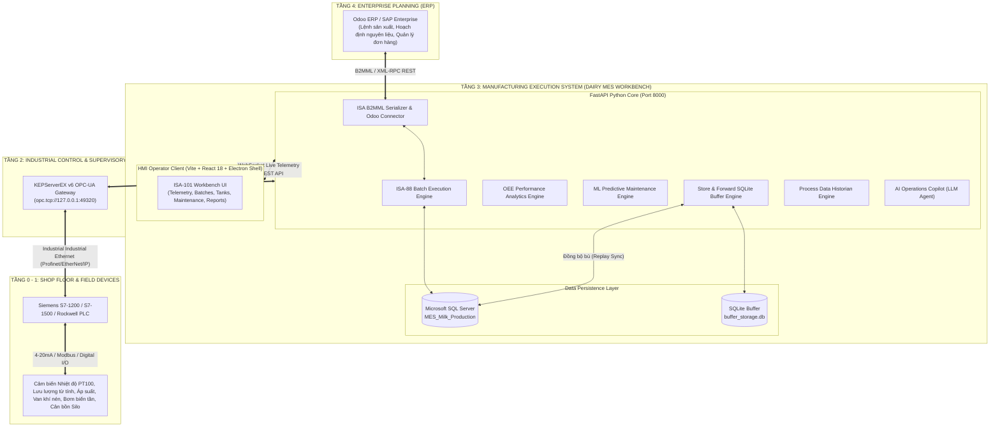
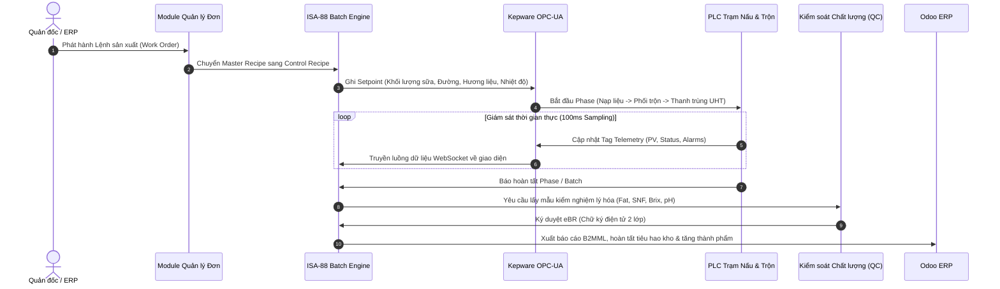
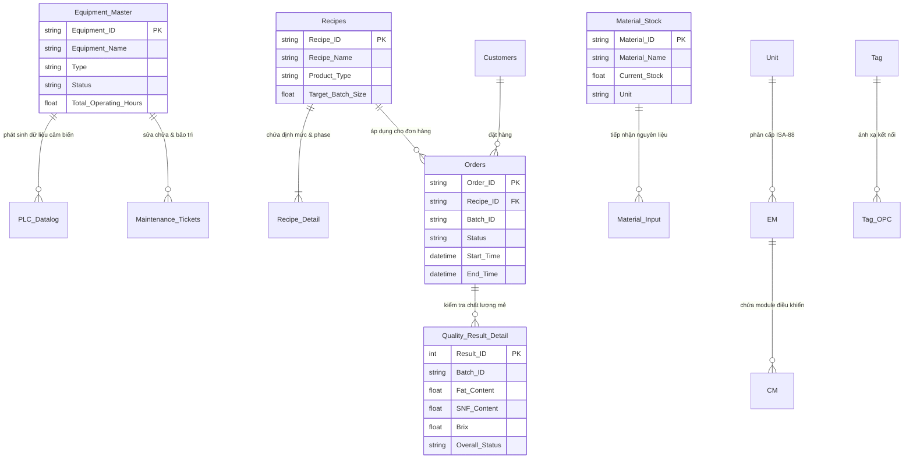

# DAIRY MES WORKBENCH — HỆ THỐNG ĐIỀU HÀNH & THỰC THI SẢN XUẤT NHÀ MÁY SỮA
### Manufacturing Execution System (MES / MOM Level 3) tuân thủ tiêu chuẩn quốc tế ISA-95 & ISA-88

[](https://www.isa.org/standards-and-publications/isa-standards/isa-standards-committees/isa95)
[](https://www.isa.org/standards-and-publications/isa-standards/isa-standards-committees/isa88)
[](https://www.isa.org/)
[](https://fastapi.tiangolo.com/)
[](https://react.dev/)
[](https://www.electronjs.org/)
[](https://www.microsoft.com/sql-server)
[-orange.svg)](https://opcfoundation.org/)

---

## 📌 MỤC LỤC
1. [Giới thiệu tổng quan & Bối cảnh đề tài](#1-giới-thiệu-tổng-quan--bối-cảnh-đề-tài)
2. [Các tiêu chuẩn công nghiệp áp dụng](#2-các-tiêu-chuẩn-công-nghiệp-áp-dụng)
3. [Kiến trúc hệ thống tổng thể (System Architecture)](#3-kiến-trúc-hệ-thống-tổng-thể-system-architecture)
4. [Sơ đồ luồng dữ liệu & Tích hợp (Data Flow & Integration)](#4-sơ-đồ-luồng-dữ-liệu--tích-hợp-data-flow--integration)
5. [Các phân hệ chức năng cốt lõi (Core Modules)](#5-các-phân-hệ-chức-năng-cốt-lõi-core-modules)
6. [Ngăn xếp công nghệ (Technology Stack)](#6-ngăn-xếp-công-nghệ-technology-stack)
7. [Mô hình cơ sở dữ liệu (Database Schema)](#7-mô-hình-cơ-sở-dữ-liệu-database-schema)
8. [Các điểm sáng kỹ thuật & Nghiên cứu học thuật](#8-các-điểm-sáng-kỹ-thuật--nghiên-cứu-học-thuật)
9. [Cấu trúc thư mục dự án (Project Directory Structure)](#9-cấu-trúc-thư-mục-dự-án-project-directory-structure)
10. [Hướng dẫn cài đặt & Vận hành (Installation & Deployment)](#10-hướng-dẫn-cài-đặt--vận-hành-installation--deployment)
11. [Thông tin tác giả & Giảng viên hướng dẫn](#11-thông-tin-tác-giả--giảng-viên-hướng-dẫn)

---

## 1. GIỚI THIỆU TỔNG QUAN & BỐI CẢNH ĐỀ TÀI

Trong bối cảnh chuyển đổi số công nghiệp (**Industry 4.0**), khoảng trống lớn nhất giữa tầng hoạch định doanh nghiệp (**ERP - Level 4**) và tầng điều khiển trực tiếp tại xưởng sản xuất (**SCADA/PLC - Level 1, 2**) là sự thiếu hụt một hệ thống điều hành sản xuất (**MES/MOM - Level 3**) tin cậy, liên tục và thời gian thực.

Đối với ngành **chế biến sữa và thực phẩm dạng lỏng (Dairy & Beverage Manufacturing)**, tính chất sản xuất theo lô (Batch Process) đòi hỏi sự kiểm soát nghiêm ngặt về nhiệt độ tiệt trùng UHT, thời gian phối trộn, định lượng vi chất, áp suất đồng hóa, chất lượng lý hóa/vi sinh và truy xuất nguồn gốc nguồn sữa tươi nguyên liệu. 

**DAIRY MES WORKBENCH** là giải pháp phần mềm cấp công nghiệp hoàn chỉnh được thiết kế và triển khai nhằm giải quyết trọn vẹn bài toán này:
* **Cầu nối 2 chiều ERP ↔ MES ↔ SCADA/PLC**: Tích hợp ERP Odoo qua chuẩn XML/JSON B2MML và kết nối PLC/SCADA thông qua máy chủ công nghiệp OPC-UA Kepware Server.
* **Tự động hóa quản lý lô theo ISA-88**: Định nghĩa và vận hành chu trình nấu sữa, phối trộn hương liệu, thanh trùng, làm nguội, lưu trữ và đóng gói.
* **Đảm bảo tính liên tục của dữ liệu**: Kiến trúc Store-and-Forward (SQLite buffer) ngăn chặn mất mát dữ liệu telemetry khi đứt kết nối mạng xưởng.
* **Hỗ trợ quyết định thông minh**: Tích hợp thuật toán Machine Learning dự đoán bảo trì thiết bị (Predictive Maintenance) và AI Operations Copilot hỗ trợ người vận hành xử lý sự cố.

---

## 2. CÁC TIÊU CHUẨN CÔNG NGHIỆP ÁP DỤNG

Hệ thống được thiết kế bám sát các tiêu chuẩn kỹ thuật tự động hóa quốc tế:

| Tiêu chuẩn | Phạm vi áp dụng trong hệ thống |
| :--- | :--- |
| **ISA-95 (IEC 62264)** | Mô hình phân cấp tích hợp hệ thống điều khiển doanh nghiệp (CIM Pyramid). Xác định rõ ranh giới Level 3 (MOM/MES) giao tiếp Level 4 (ERP) và Level 2 (SCADA). |
| **ISA-88 (IEC 61512)** | Mô hình điều khiển sản xuất theo lô (Batch Control). Tổ chức phân cấp vật lý: *Enterprise $\to$ Site $\to$ Area $\to$ Process Cell $\to$ Unit $\to$ Equipment Module (EM) $\to$ Control Module (CM)*; và mô hình thủ tục quy trình: *Procedure $\to$ Unit Procedure $\to$ Operation $\to$ Phase*. |
| **B2MML (IEC/ISO)** | *Business To Manufacturing Markup Language* — Chuẩn hóa lược đồ dữ liệu trao đổi giữa MES và ERP (lệnh sản xuất, định mức vật tư BOM, trạng thái lô, xác nhận tiêu hao). |
| **ISA-101** | Tiêu chuẩn thiết kế giao diện HMI hiệu năng cao (*High-Performance HMI*). Tối ưu hóa độ tương phản, nền trung tính (slate/paper), chỉ dùng màu cảnh báo (Đỏ/Vàng/Xanh) cho sự kiện thực tế, giảm thiểu mỏi mắt cho người vận hành. |
| **ISA-18.2** | Chuẩn quản lý hệ thống cảnh báo công nghiệp (*Alarm Management Lifecycle*). Quản lý chuông báo, trạng thái kích hoạt, xác nhận (Ack), phân loại mức độ ưu tiên và nhật ký sự cố. |
| **21 CFR Part 11 Concept** | Nguyên tắc hồ sơ lô điện tử (eBR - Electronic Batch Record), chữ ký số 2 lớp xác thực chất lượng và nhật ký kiểm toán người dùng (*Audit Trail*) bất biến. |

---

## 3. KIẾN TRÚC HỆ THỐNG TỔNG THỂ (SYSTEM ARCHITECTURE)

Hệ thống được phân bổ chính xác theo tháp phân cấp tự động hóa 4 tầng của ISA-95:



---

## 4. SƠ ĐỒ LUỒNG DỮ LIỆU & TÍCH HỢP (DATA FLOW & INTEGRATION)

### 4.1. Chu trình thực thi Lô sản xuất (Batch Execution Cycle)


---

## 5. CÁC PHÂN HỆ CHỨC NĂNG CỐT LÕI (CORE MODULES)

Hệ thống được cấu trúc thành **8 phân hệ nghiệp vụ hoàn chỉnh** hiển thị trực quan trên giao diện làm việc:

```
┌──────────────────────────────────────────────────────────────────────────────────┐
│                             DAIRY MES WORKBENCH                                  │
├──────────────┬──────────────┬──────────────┬──────────────┬──────────────────────┤
│ 1. CONFIG    │ 2. ISA-88    │ 3. MASTER    │ 4. OPERATIONS│ 5. OEE ANALYTICS     │
├──────────────┼──────────────┼──────────────┼──────────────┼──────────────────────┤
│ 6. QUALITY   │ 7. INVENTORY │ 8. MAINT     │ 9. REPORTS   │ 10. AI COPILOT       │
└──────────────┴──────────────┴──────────────┴──────────────┴──────────────────────┘
```

### 1. Phân hệ Cấu hình Hệ thống (System Configuration)
* **Kết nối Microsoft SQL Server**: Quản lý chuỗi kết nối (`localhost\WINCC -> MES_Milk_Production`), kiểm tra trạng thái driver ODBC, kiểm tra sức khỏe bảng dữ liệu.
* **Kết nối Máy chủ OPC-UA**: Cấu hình Endpoint KEPServerEX (`opc.tcp://127.0.0.1:49320`), chu kỳ lấy mẫu (Sampling rate 100ms), theo dõi kênh/thiết bị PLC.
* **Cấu hình Tích hợp Odoo ERP**: Thiết lập kết nối XML-RPC/JSON-RPC, cơ sở dữ liệu `dairy_erp`, đồng bộ hóa đơn hàng tự động.
* **Giám sát Store & Forward**: Hiển thị kích thước buffer cục bộ, hàng đợi bản ghi chờ đẩy lên cơ sở dữ liệu chính.

### 2. Phân hệ Mô hình Lô ISA-88 (ISA-88 Batch Model)
* **Cây phân cấp vật lý trực quan**: Quản trị tài sản theo chuẩn ISA-88 từ Process Cell $\to$ Unit (Bồn trộn T-01, Thiết bị thanh trùng UHT-01, Bồn đệm tiệt trùng B-01, Máy rót đóng hộp F-01) $\to$ Thiết bị EM $\to$ Mô-đun điều khiển CM.
* **OPC Tag Mapping Engine**: Cho phép ánh xạ động các tag PLC từ Kepware vào từng Unit/Equipment Module mà không cần biên dịch lại code.
* **Kepware Tree Scanner & Pinned Tag Palette**: Bộ quét trực tiếp cấu trúc Tag từ máy chủ OPC-UA, hỗ trợ ghim các Tag quan trọng lên thanh công cụ giám sát nhanh.

### 3. Phân hệ Quản lý Dữ liệu Chủ (Master Data Management)
* **Công thức sản phẩm (Recipes)**: Quản lý công thức định mức (Master Recipes) cho các dòng sản phẩm sữa: Sữa tươi tiệt trùng nguyên chất, Có đường, Sữa chua lên men, Sữa hương dâu, Socola...
* **Thông số quy trình (BOM & Process Parameters)**: Định mức nguyên liệu (Sữa thô, Đường mía, Bột hương liệu, Chất ổn định) cùng chỉ số cài đặt (Nhiệt độ UHT 137°C, Áp suất đồng hóa 200 bar, Thời gian ủ, Tốc độ khuấy RPM).
* **Quản lý Đơn hàng (Work Orders)**: Tiếp nhận lệnh sản xuất tự động từ ERP hoặc lập thủ công tại xưởng, tính toán khối lượng mẻ, ngày giao hàng và độ ưu tiên.

### 4. Phân hệ Vận hành & Thực thi Lô (Operations & Batch Execution)
* **Bộ điều phối mẻ (Batch Dispatcher)**: Cấp phát mã lô (`LOT-YYYYMMDD-XXX`), tải Master Recipe thành Control Recipe, kiểm tra điều kiện an toàn trước khi nạp mẻ.
* **Máy trạng thái ISA-88 State Machine**: Điều khiển trạng thái mẻ sản xuất chuẩn quốc tế (*IDLE $\to$ RUNNING $\to$ PAUSED $\to$ HOLDING $\to$ HELD $\to$ RESTARTING $\to$ COMPLETED $\to$ ABORTED*).
* **Biểu đồ Gantt & Timeline công đoạn**: Giám sát thời gian thực tiến độ từng bước công nghệ: Nạp sữa $\to$ Gia nhiệt sơ bộ $\to$ Phối trộn $\to$ Đồng hóa $\to$ Tiệt trùng UHT $\to$ Làm mát $\to$ Chiết rót vô trùng.
* **Tự động bù sai số định lượng (AI Dosing Offset)**: Thuật toán tự điều chỉnh thời điểm ngắt van dựa trên độ nhớt và quán tính dòng chảy.

### 5. Phân hệ Giám sát Hiệu suất Thiết bị (OEE Performance Dashboard)
* **Chỉ số OEE thời gian thực**: Tự động tính toán bộ 3 chỉ số then chốt:
  $$\text{OEE} = \text{Availability} \times \text{Performance} \times \text{Quality}$$
* **Chỉ số độ tin cậy**: Tính toán chu kỳ hỏng hóc trung bình (**MTBF**) và thời gian sửa chữa trung bình (**MTTR**).
* **Biểu đồ Pareto 6 tổn thất lớn (Six Big Losses)**: Phân tích nguyên nhân dừng máy (Sự cố cơ khí, Chờ nguyên liệu, Vệ sinh CIP, Giảm tốc độ, Sản phẩm lỗi...).
* **Phân tích theo ca làm việc**: Đánh giá hiệu suất riêng biệt theo từng ca sản xuất (Ca 1, Ca 2, Ca 3) và theo từng dây chuyền.

### 6. Phân hệ Quản lý Chất lượng & Hồ sơ Lô Điện tử (Quality & eBR)
* **Kiểm nghiệm chất lượng Online & Offline**: Ghi nhận thông số kiểm tra lý hóa (Tỷ lệ béo Fat %, Hàm lượng chất khô không béo SNF %, Độ chua, Tỷ trọng, Độ Brix) và kết quả xét nghiệm vi sinh.
* **Hồ sơ lô điện tử (eBR - Electronic Batch Record)**: Tự động gom toàn bộ dữ liệu lịch sử của mẻ sữa: thời điểm bắt đầu/kết thúc, đồ thị nhiệt độ UHT, sai lệch định lượng, danh sách nguyên liệu đã tiêu hao và các cảnh báo phát sinh.
* **Chữ ký điện tử 2 lớp (Dual Digital Signatures)**: Cơ chế ký duyệt nghiệm thu giữa Kỹ thuật viên kiểm tra chất lượng (QC Inspector) và Quản đốc ca sản xuất (Production Supervisor) với mã băm bảo mật.

### 7. Phân hệ Tồn kho & Giám sát Bồn chứa (Material Inventory & Tank Telemetry)
* **Giám sát bồn chứa thời gian thực (Tank Telemetry)**: Hiển thị trực quan mức bồn (Level %), thể tích thực tế (Liters), nhiệt độ bồn và trạng thái vệ sinh CIP (*Clean-In-Place*) cho hệ thống Silo sữa thô, bồn phối trộn và bồn đệm vô trùng.
* **Bảng hiệu chuẩn bồn phi tuyến tính (Tank Strapping Table)**: Chuyển đổi chính xác từ áp suất/chiều cao mức chất lỏng sang thể tích cho các loại bồn đáy nón và chỏm cầu.
* **Quy trình tiếp nhận sữa tươi nguyên liệu (Inbound Raw Milk)**: Quản lý tiếp nhận xe bồn, cân đầu vào, kiểm tra nhanh kháng sinh/chất bảo quản trước khi cấp phép bơm vào Silo.
* **Cân bằng khối lượng (Mass Balance)**: Tự động đối soát khối lượng nguyên liệu đưa vào so với tổng sản phẩm đầu ra để cảnh báo rò rỉ hoặc thất thoát.

### 8. Phân hệ Quản lý Thiết bị & Bảo trì Dự đoán (Equipment & Predictive Maintenance)
* **Hồ sơ lý lịch thiết bị (Asset Management)**: Quản lý danh mục 12+ thiết bị cốt lõi trong xưởng sản xuất sữa (Bơm ly tâm, Thiết bị trao đổi nhiệt, Máy đồng hóa áp lực cao, Máy chiết rót...).
* **Bảo trì dự đoán bằng Máy học (Machine Learning PdM)**: 
  * Thu thập dữ liệu rung động RMS, nhiệt độ ổ bi, áp suất ngược.
  * Trích xuất đặc trưng miền thời gian/tần số (Kurtosis, Skewness, Crest Factor, FFT Peak).
  * Dự báo tuổi thọ còn lại (**RUL - Remaining Useful Life**) và phân loại rủi ro hỏng hóc sớm (Bearing Fault, Cavitation hiện tượng xâm thực bơm).
* **Phiếu yêu cầu bảo trì (Work Orders & Maintenance Tickets)**: Tự động kích hoạt phiếu sửa chữa khi cảm biến rung động vượt ngưỡng cảnh báo rung theo chuẩn ISO 10816.

### 9. Trung tâm Báo cáo Doanh nghiệp & Nhật ký Kiểm toán (Reports & Audit Trail)
* **Xuất báo cáo chuyên nghiệp**: Xuất báo cáo sản lượng, báo cáo chất lượng, báo cáo OEE ra định dạng **Excel (.xlsx)** và **PDF (.pdf)** kèm biểu đồ trực quan.
* **Nhật ký cảnh báo (ISA-18.2 Alarm History)**: Lưu trữ lịch sử báo động, tần suất phát sinh, thời gian phản hồi của nhân viên vận hành.
* **Nhật ký kiểm toán người dùng (User Action Audit Trail)**: Ghi vết toàn bộ hành vi: đăng nhập, thay đổi thông số cài đặt (setpoint change), can thiệp thủ công, dừng khẩn cấp.

### 10. Trợ lý Vận hành Trí tuệ Nhân tạo (AI Operations Copilot)
* Tích hợp mô hình ngôn ngữ lớn (LLM Claude 3.5 Sonnet / OpenAI) hỗ trợ phân tích nguyên nhân gốc rễ (Root Cause Analysis) khi mẻ sản xuất phát sinh lỗi hoặc cảnh báo chất lượng.
* Đề xuất phương án xử lý sự cố thiết bị nhanh chóng theo đúng quy trình chuẩn (SOP).

---

## 6. NGĂN XẾP CÔNG NGHỆ (TECHNOLOGY STACK)

### Giao diện Người dùng (Frontend & Desktop Shell)
* **Ngôn ngữ & Nền tảng**: React 18, TypeScript 5, Vite 6 (build siêu nhanh, HMR tức thì).
* **Desktop Shell**: Electron 44 (đóng gói ứng dụng desktop chuẩn công nghiệp, khởi động dạng Fast-Boot Splash Screen).
* **Styling & Thiết kế HMI**: Tailwind CSS 3.4, Tokens CSS chuẩn Hallmark Industrial Workbench (tuyệt đối không dùng AI Slop, không gradient lòe loẹt, tuân thủ nghiêm ngặt 8 trạng thái tương tác).
* **Trực quan hóa Dữ liệu**: Recharts (biểu đồ OEE, biểu đồ Pareto, xu hướng nhiệt độ/áp suất thời gian thực), Lucide React Icons.
* **Xử lý Xuất file**: SheetJS (`xlsx`) cho bảng tính Excel và jsPDF cho tài liệu báo cáo PDF.

### Máy chủ Dịch vụ (Backend & Industrial Engines)
* **Ngôn ngữ**: Python 3.12 64-bit.
* **Web Framework**: FastAPI (asynchronous, hiệu năng cao, tài liệu hóa OpenAPI/Swagger tự động).
* **Giao tiếp Thời gian thực**: WebSocket (`/ws/telemetry`) truyền dữ liệu cảm biến đa luồng với tần số 100ms.
* **Giao thức Công nghiệp**: `asyncua` (Thư viện OPC-UA Python bất đồng bộ kết nối Kepware).
* **Kết nối Cơ sở dữ liệu**: `pyodbc` kết nối Microsoft SQL Server qua ODBC Driver 17.
* **Khoa học Dữ liệu & AI**: `numpy`, `scipy` (xử lý tín hiệu, FFT), `scikit-learn` (mô hình Random Forest / Isolation Forest dự báo bảo trì PdM).

### Cơ sở Dữ liệu & Lưu trữ (Persistence Layer)
* **Hệ quản trị CSDL Doanh nghiệp**: **Microsoft SQL Server (MSSQL$WINCC)** — Lưu trữ tập trung dữ liệu mẻ, công thức, nhật ký cảnh báo, chất lượng và lệnh sản xuất.
* **Cơ sở dữ liệu Đệm ngoại tuyến**: **SQLite 3 (`buffer_storage.db`)** — Triển khai cơ chế Store-and-Forward đảm bảo an toàn dữ liệu 100% khi mất kết nối mạng xưởng.

---

## 7. MÔ HÌNH CƠ SỞ DỮ LIỆU (DATABASE SCHEMA)

Dự án sử dụng cơ sở dữ liệu quan hệ đồng bộ trên Microsoft SQL Server với tên database: `MES_Milk_Production`.



---

## 8. CÁC ĐIỂM SÁNG KỸ THUẬT & NGHIÊN CỨU HỌC THUẬT

1. **Cơ chế Store & Forward Chống Mất Dữ Liệu**:
   * Khi đường truyền từ máy tính xưởng đến máy chủ SQL Server trung tâm bị ngắt quãng, toàn bộ gói tin telemetry từ PLC lập tức được định tuyến vào SQLite local buffer.
   * Ngay khi dịch vụ SQL Server hoạt động trở lại, một tiến trình chạy ngầm (`db_sync_engine.py`) sẽ thực hiện cơ chế *Replay Sync* đẩy bù dữ liệu tuần tự với con dấu thời gian nguyên bản (Zero Telemetry Loss).

2. **Khả năng Mở Rộng B2MML Chuẩn ISA-95**:
   * Hệ thống tích hợp bộ tuần tự hóa `isa_b2mml_serializer.py` cho phép nhập và xuất các thông điệp `ProductionSchedule`, `ProductionPerformance`, `MaterialActual` dưới dạng tài liệu XML hợp chuẩn, sẵn sàng tích hợp với bất kỳ hệ thống ERP doanh nghiệp nào (SAP, Oracle, Odoo).

3. **Mô hình Bảo Trì Dự Đoán Máy Học (Machine Learning PdM)**:
   * Ứng dụng trích xuất đặc trưng thống kê và phổ tần số rung động động cơ, bơm ly tâm để phát hiện sớm các hiện tượng xâm thực (Cavitation) và nứt ổ lăn trước khi sự cố dừng máy thực sự xảy ra.

4. **Thiết kế Giao diện Chuẩn Công Nghiệp ISA-101 (Không AI-Slop)**:
   * Toàn bộ mã nguồn giao diện tuân thủ quy tắc **Hallmark Design System**: sử dụng font chữ kỹ thuật (`Space Grotesk`, `Inter`, `JetBrains Mono`), bảng màu Slate/Cool-Paper, hỗ trợ đầy đủ 8 trạng thái tương tác cho mọi nút bấm và ô nhập liệu (Default, Hover, Focus, Active, Disabled, Loading, Error, Success) mà không bị nhảy layout (zero layout shift).

---

## 9. CẤU TRÚC THƯ MỤC DỰ ÁN (PROJECT DIRECTORY STRUCTURE)

```
MES/
├── backend/                        # Máy chủ dịch vụ Python FastAPI & Công nghệ công nghiệp
│   ├── routes/                     # Các router phân hệ (Quality, Maintenance,...)
│   ├── ai_copilot.py               # Trợ lý AI phân tích sự cố vận hành
│   ├── batch_engine.py             # Động cơ quản lý mẻ sản xuất theo chuẩn ISA-88
│   ├── db_connector.py             # Bộ điều hợp kết nối Microsoft SQL Server
│   ├── db_routes.py                # RESTful API cung cấp dữ liệu nghiệp vụ
│   ├── db_sync_engine.py           # Động cơ đồng bộ dữ liệu Store-and-Forward
│   ├── historian.py                # Thu thập & nén dữ liệu chuỗi thời gian (Historian)
│   ├── init_sql.py                 # Kịch bản khởi tạo bảng & dữ liệu mẫu SQL Server
│   ├── isa_b2mml_serializer.py     # Bộ chuyển đổi chuẩn ISA-95 B2MML
│   ├── kepware_gateway.py          # Cổng giao tiếp OPC-UA bất đồng bộ & WebSocket server
│   ├── main.py                     # Điểm khởi chạy thống nhất của Backend
│   ├── ml_pdm_engine.py            # Mô hình Machine Learning bảo trì dự đoán
│   ├── odoo_connector.py           # Module kết nối ERP Odoo qua XML-RPC
│   ├── oee_engine.py               # Động cơ tính toán OEE, MTBF, MTTR
│   ├── opc_routes.py               # API điều khiển và đọc ghi tag PLC
│   ├── requirements.txt            # Danh sách gói phụ thuộc Python
│   └── run_backend.bat             # File khởi động riêng cho Backend
├── electron/                       # Nền tảng ứng dụng Desktop
│   ├── main.cjs                    # Mã nguồn chính quản lý cửa sổ Electron & Fast-boot Splash
│   └── preload.js                  # Cầu nối an toàn IPC giữa Electron và Web
├── src/                            # Mã nguồn giao diện người dùng React 18 & TypeScript
│   ├── components/                 # Các thành phần giao diện tái sử dụng
│   │   ├── auth/                   # Màn hình đăng nhập & xác thực
│   │   ├── config/                 # Thẻ cấu hình Gateway, Database, ERP
│   │   ├── inventory/              # Thẻ hiển thị trực quan bồn chứa sữa, modal hiệu chuẩn
│   │   ├── masterData/             # Quản lý công thức, đơn hàng
│   │   ├── operations/             # Bộ điều phối mẻ, timeline công đoạn
│   │   ├── quality/                # Kiểm tra chất lượng, modal chữ ký điện tử eBR
│   │   ├── layout/                 # Thanh điều hướng Navbar, Header
│   │   └── ActiveAlarmBanner.tsx   # Thanh cảnh báo sự cố thường trực chuẩn ISA-18.2
│   ├── context/                    # React Context quản lý trạng thái từng phân hệ
│   ├── pages/                      # Các trang màn hình nghiệp vụ
│   ├── services/                   # Lớp gọi API (api.ts) và WebSocket client
│   ├── styles/                     # Token màu sắc và thiết kế CSS chuẩn Hallmark
│   ├── types/                      # Định nghĩa kiểu dữ liệu TypeScript nghiêm ngặt
│   ├── views/                      # Các khung nhìn chính (Views) tương ứng từng phân hệ
│   ├── App.tsx                     # Điểm khởi đầu ứng dụng React & định tuyến View
│   └── main.tsx                    # Render DOM React
├── public/                         # Tài nguyên tĩnh, biểu tượng và hình ảnh nhà máy
├── Run_App.bat                     # File chạy 1-Click tự động bật toàn bộ hệ thống
├── Stop_App.bat                    # File tắt sạch toàn bộ tiến trình hệ thống
├── package.json                    # Cấu hình dự án Node.js & dependencies
├── tailwind.config.js              # Cấu hình bảng màu công nghiệp Tailwind
├── tsconfig.json                   # Cấu hình TypeScript
└── vite.config.ts                  # Cấu hình trình đóng gói Vite
```

---

## 10. HƯỚNG DẪN CÀI ĐẶT & VẬN HÀNH (INSTALLATION & DEPLOYMENT)

### 10.1. Yêu cầu môi trường tiên quyết (Prerequisites)
1. **Hệ điều hành**: Windows 10 / Windows 11 (64-bit) hoặc Windows Server.
2. **Node.js**: Phiên bản `>= 18.x` hoặc `20.x` LTS (kèm `npm`).
3. **Python**: Phiên bản `3.10`, `3.11` hoặc `3.12` (64-bit). Đã tích hợp `pip` và thêm vào biến môi trường PATH.
4. **Cơ sở dữ liệu**: Microsoft SQL Server (bất kỳ phiên bản nào từ 2014 đến 2022 hoặc phiên bản `MSSQL$WINCC`).
5. **ODBC Driver**: Đã cài đặt `ODBC Driver 17 for SQL Server`.
6. *(Tùy chọn)*: **KEPServerEX v6** nếu kết nối trực tiếp đến PLC thực hoặc mô phỏng OPC-UA.

---

### 10.2. Khởi chạy 1-Click (Khuyến nghị cho Giảng viên / Đánh giá nhanh)

Hệ thống đã được thiết kế sẵn kịch bản khởi động thông minh `Run_App.bat`. Bạn chỉ cần:

```bat
# Nhấp đúp chuột vào file:
Run_App.bat
```

**Kịch bản `Run_App.bat` sẽ tự động thực hiện:**
1. Tự động kiểm tra và khởi động dịch vụ SQL Server (`MSSQL$WINCC`).
2. Dọn dẹp và giải phóng các cổng mạng 8000 (Backend) và 5173 (Frontend).
3. Tự động phát hiện và lựa chọn môi trường Python tương thích.
4. Chạy ngầm máy chủ Vite Dev Server (`localhost:5173`).
5. Chạy ngầm máy chủ thống nhất FastAPI Gateway (`localhost:8000`).
6. Khởi động vỏ Desktop Electron hiển thị cửa sổ làm việc MES với giao diện Splash Screen dưới 1.5 giây.
7. Khi đóng ứng dụng, toàn bộ tiến trình nền được dọn dẹp sạch sẽ (Zero Background Footprint).

Để tắt toàn bộ hệ thống thủ công: Nhấp đúp chuột vào file `Stop_App.bat`.

---

### 10.3. Khởi chạy thủ công từng phần (Dành cho Lập trình viên / Debug)

#### Bước 1: Cài đặt thư viện Frontend & Desktop
Mở terminal tại thư mục gốc dự án `d:\MES`:
```bash
npm install
```

#### Bước 2: Cài đặt thư viện Backend
Mở terminal tại thư mục `backend`:
```bash
cd backend
pip install -r requirements.txt
```

#### Bước 3: Khởi tạo cơ sở dữ liệu mẫu SQL Server (nếu chạy lần đầu)
```bash
python init_sql.py
```

#### Bước 4: Khởi động Backend Server
```bash
python kepware_gateway.py
# Backend sẽ lắng nghe tại: http://127.0.0.1:8000
# Tài liệu API Swagger có thể xem tại: http://127.0.0.1:8000/docs
```

#### Bước 5: Khởi động Giao diện Frontend / Electron
Mở một cửa sổ terminal mới tại thư mục gốc:
```bash
# Chạy trên trình duyệt Web:
npm run dev
# Truy cập giao diện tại: http://localhost:5173

# Hoặc khởi chạy trong giao diện Desktop Electron:
npm run electron:dev
```

---

## 11. THÔNG TIN TÁC GIẢ & GIẢNG VIÊN HƯỚNG DẪN

* **Đơn vị đào tạo**: TRƯỜNG ĐẠI HỌC BÁCH KHOA - ĐẠI HỌC QUỐC GIA TP. HỒ CHÍ MINH (HCMUT)
* **Khoa**: Điện - Điện tử / Bộ môn Điều khiển Tự động
* **Đề tài tốt nghiệp / Nghiên cứu**: *Nghiên cứu, Thiết kế và Triển khai Hệ thống Điều hành Sản xuất (MES) cho Nhà máy Chế biến Sữa tuân thủ chuẩn ISA-95 và ISA-88*
* **Sinh viên thực hiện**: 
  * Họ và tên: **Lê Quốc Thanh**
  * Email liên hệ: `thanh.lethanhlequoc@hcmut.edu.vn`
* **Giảng viên hướng dẫn**: 
  * *[Điền học hàm, học vị và tên Giảng viên hướng dẫn tại đây]*
* **Thời gian thực hiện**: 2026

---
*(Bản quyền mã nguồn thuộc về tác giả - Dự án phục vụ mục đích nghiên cứu học thuật và ứng dụng công nghiệp)*
